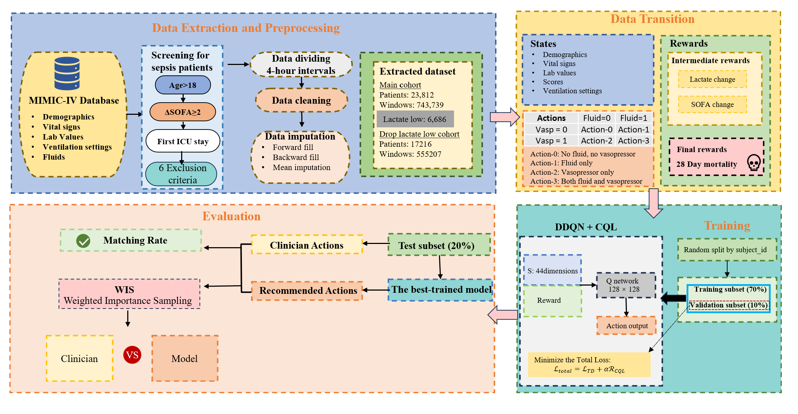

## Workflow

### Pipeline Overview
1. **Data Extraction and Preprocessing**: We extract sepsis trajectories from MIMIC-IV using SQL, apply inclusion/exclusion criteria, split records into 4-hour windows, perform cleaning and missing value imputation.
2. **MDP Construction**: Formulate sequential ICU treatment as an MDP. States include patient physiological features; actions are fluid/vasopressor decisions; reward is defined based on lactate, SOFA and 28-day mortality outcome.
3. **Offline RL Training**: Train Double DQN with CQL regularization on retrospective trajectories, split by patient ID to avoid data leakage.
4. **Evaluation**: Compare policy recommendations against clinician decisions using matching rate and weighted importance sampling (WIS).
